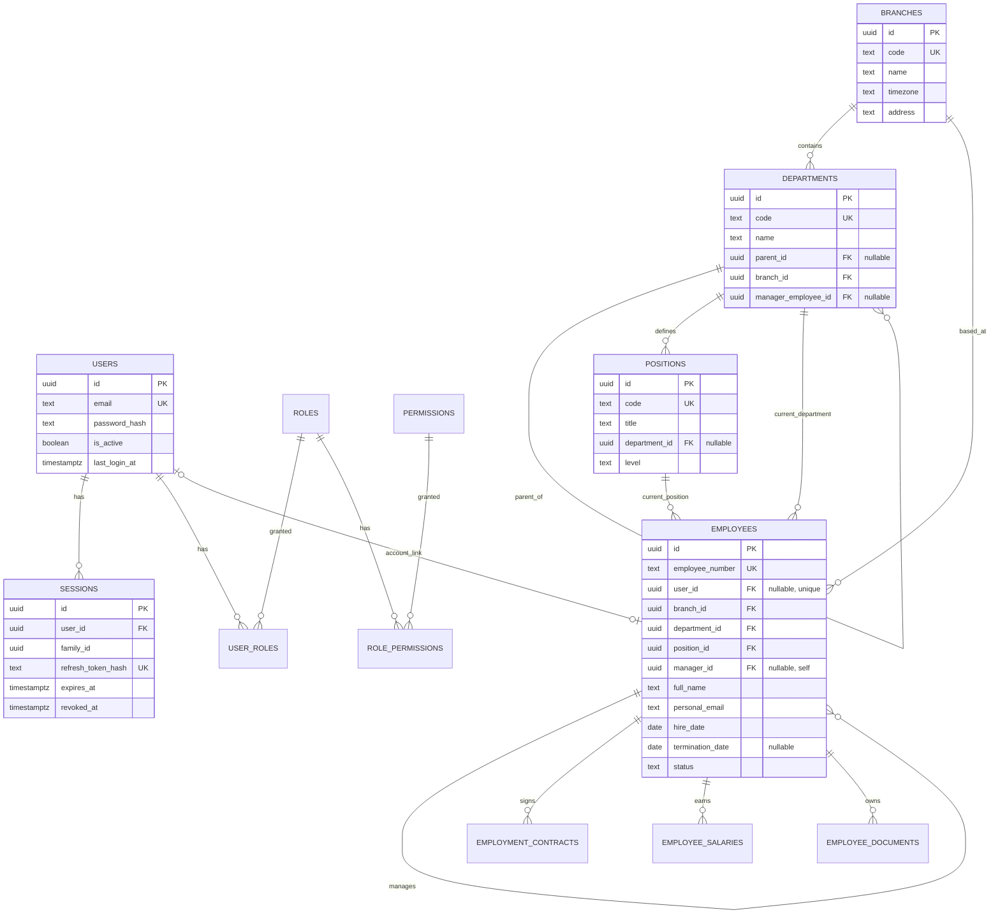

# PeopleOps — Initial Database Design (ERD Proposal)

Status: Phase 0 proposal. **No Prisma models are generated yet** (per Phase 0 §6). Phase 1 creates
only the infrastructure needed for migrations; domain tables arrive with their modules.

Database: PostgreSQL. Naming: tables `snake_case` plural, PK `id uuid` (`gen_random_uuid()`),
timestamps `created_at` / `updated_at` `timestamptz` UTC. Money: `numeric(14,2)`.

## 1. Core ERD (auth → organization → employees)

Notes:

- `users` and `employees` are independent. The link is a nullable unique `employees.user_id`
  (one account per employee, one employee per account), enforced by a unique index.
- `departments.parent_id` supports hierarchy; cycles are rejected in the service layer (a database
  trigger is possible later if needed).
- `employees.manager_id` is the reporting line; `departments.manager_employee_id` is the department
  head, which may differ.

## 2. Employment history and compensation

| Table | Key columns | Notes |
| --- | --- | --- |
| `employment_contracts` | `employee_id`, `contract_type`, `start_date`, `end_date` nullable, `signed_at`, `document_id` | An employee may have several contracts over time; date ranges must not overlap per employee |
| `employee_salaries` | `employee_id`, `base_salary numeric(14,2)`, `currency char(3)`, `effective_from date`, `effective_to date` nullable, `reason` | Append-only history. Current salary = row where `effective_to IS NULL`. Overlap prevented by a partial exclusion constraint or service check inside a transaction |
| `employee_documents` | `employee_id`, `document_type`, `storage_key`, `mime_type`, `size_bytes`, `uploaded_by`, `expires_at` | Never publicly addressable; access via authorized endpoint (ADR-014) |

Salary history is **not** denormalized onto `employees`. Payroll reads the effective salary for the
period it is processing, so later salary changes never rewrite issued payslips.

## 3. Attendance

| Table | Key columns | Notes |
| --- | --- | --- |
| `attendance_records` | `employee_id`, `work_date date`, `clock_in_at timestamptz`, `clock_out_at timestamptz`, `status`, `source`, `worked_minutes int`, `note` | **Unique `(employee_id, work_date)`** — one record per employee per work day; idempotent clock endpoints |
| `attendance_corrections` | `attendance_record_id`, `requested_by`, `approved_by`, `old_values jsonb`, `new_values jsonb`, `status` | Corrections are auditable; the original record keeps its history |

`work_date` is derived in the **company timezone** (ADR-007), so a 23:30 clock-in in Jakarta is
attributed to the Jakarta work date, not the UTC date.

Indexes: `(work_date, status)` for daily reports, `(employee_id, work_date DESC)` for personal
history.

## 4. Leave and overtime

| Table | Key columns | Notes |
| --- | --- | --- |
| `leave_types` | `code UK`, `name`, `annual_quota_days numeric(5,1)`, `requires_attachment`, `is_paid` | Configuration data |
| `leave_balances` | `employee_id`, `leave_type_id`, `period_year`, `entitled`, `used`, `pending`, `carried_over` | Materialized current balance; **unique `(employee_id, leave_type_id, period_year)`** |
| `leave_balance_transactions` | `employee_id`, `leave_type_id`, `period_year`, `delta numeric(5,1)`, `reason`, `reference_type`, `reference_id`, `created_at` | Append-only ledger. `leave_balances` is the transactionally maintained projection; it must always equal the sum of deltas |
| `leave_requests` | `employee_id`, `leave_type_id`, `start_date`, `end_date`, `day_count numeric(5,1)`, `reason`, `status`, `approval_request_id` | Overlap per employee rejected in the service layer |
| `overtime_requests` | `employee_id`, `work_date`, `planned_minutes`, `approved_minutes`, `status`, `approval_request_id` | Actual overtime is reconciled with attendance |

**Transaction-sensitive:** submitting a leave request either (a) reserves balance
(`pending += dayCount` + ledger entry) inside one `$transaction`, or (b) moves `pending → used` on
approval. Rejection reverses the reservation. Concurrency is handled by a row lock
(`SELECT ... FOR UPDATE` on the balance row) or an atomic conditional update, never read-modify-write
in application code.

## 5. Approval workflow

| Table | Key columns | Notes |
| --- | --- | --- |
| `approval_requests` | `subject_type` (`leave` \| `overtime` \| ...), `subject_id`, `requester_user_id`, `status`, `current_step`, `completed_at` | **Unique `(subject_type, subject_id)`** — one approval flow per subject |
| `approval_steps` | `approval_request_id`, `step_order`, `approver_employee_id`, `decision` (`pending`/`approved`/`rejected`/`skipped`), `decided_by_user_id`, `decided_at`, `comment` | Unique `(approval_request_id, step_order)` |
| `approval_delegations` | `approver_employee_id`, `delegate_employee_id`, `starts_at`, `ends_at` | Out-of-office delegation |

State transitions are guarded in the service: only the current pending step's approver may decide,
and the decision + next step + final status update happen in one transaction. Self-approval is
blocked by policy.

## 6. Payroll

| Table | Key columns | Notes |
| --- | --- | --- |
| `salary_components` | `code UK`, `name`, `type` (`earning`/`deduction`), `is_taxable`, `is_fixed` | Configuration |
| `payroll_periods` | `year`, `month`, `status` (`draft`/`processing`/`published`/`closed`), `cutoff_date` | **Unique `(year, month)`** |
| `payslips` | `payroll_period_id`, `employee_id`, `gross numeric(14,2)`, `total_deductions`, `net`, `currency`, `status`, `published_at` | **Unique `(payroll_period_id, employee_id)`** |
| `payslip_lines` | `payslip_id`, `salary_component_id`, `description`, `amount`, `quantity`, `rate` | Snapshot of calculated values, not references to live salary data |
| `payslip_adjustments` | `payslip_id`, `type`, `amount`, `reason`, `created_by`, `approved_by` | Corrections to published payroll are separate, traceable records — published payslips are never silently mutated |

Payroll generation is a single transaction per period (or per employee batch) and is idempotent:
re-running for an un-published period replaces draft results; a published period requires an
explicit adjustment/correction flow.

## 7. Performance and learning (later)

- `review_cycles` (`name`, `start_date`, `end_date`, `status`), `reviews` (unique
  `(cycle_id, employee_id)`), `goals` (`employee_id`, `cycle_id`, `title`, `weight`, `progress`).
- `courses` (`code UK`, `title`, `provider`), `course_sessions` (`course_id`, `starts_at`,
  `ends_at`, `capacity`), `enrollments` (unique `(employee_id, course_session_id)`, `status`).

## 8. Notifications and audit

| Table | Key columns | Notes |
| --- | --- | --- |
| `notifications` | `user_id`, `type`, `title`, `body`, `payload jsonb`, `read_at`, `created_at` | Index `(user_id, read_at)` for the unread badge |
| `audit_logs` | `actor_user_id` nullable, `action`, `entity_type`, `entity_id`, `before jsonb`, `after jsonb`, `ip`, `user_agent`, `created_at` | Append-only, no updates/deletes; index `(entity_type, entity_id, created_at DESC)` and `(actor_user_id, created_at DESC)` |

Audit covers at minimum: login success/failure, role and permission changes, employee create/update/
terminate, salary changes, leave balance adjustments, approval decisions, payroll publish/close,
document download by an admin.

## 9. Cross-cutting constraints and indexes

- UUID primary keys; foreign keys with explicit `onDelete` (`Restrict` for master data referenced by
  history, `Cascade` only for true child rows such as `payslip_lines`).
- Unique: `users.email` (case-insensitive — store normalized lowercase), `employees.employee_number`,
  `branches.code`, `departments.code`, `positions.code`, `attendance_records(employee_id, work_date)`,
  `leave_balances(employee_id, leave_type_id, period_year)`,
  `payslips(payroll_period_id, employee_id)`, `approval_requests(subject_type, subject_id)`.
- Indexes for list screens: `employees(status, department_id)`, `employees(manager_id)`,
  `employees(full_name)`, `leave_requests(employee_id, status)`,
  `leave_requests(status, created_at DESC)`, `approval_steps(approver_employee_id, decision)`.
- Soft delete is avoided for core employee records: use `termination_date` + `status`. Master data
  that must disappear from selects gets an `is_active` flag instead of a hard delete.

## 10. Ownership vs. cross-module reads

Each table has exactly one owning module (see `system-overview.md` §5). Reports do not read tables
directly; they consume read services exposed by `employees`, `attendance`, `leave`, `payroll`.
Foreign keys may cross modules (e.g. `leave_requests.employee_id → employees.id`), but joins inside a
module's repository are limited to its own tables plus explicitly exported read models.
