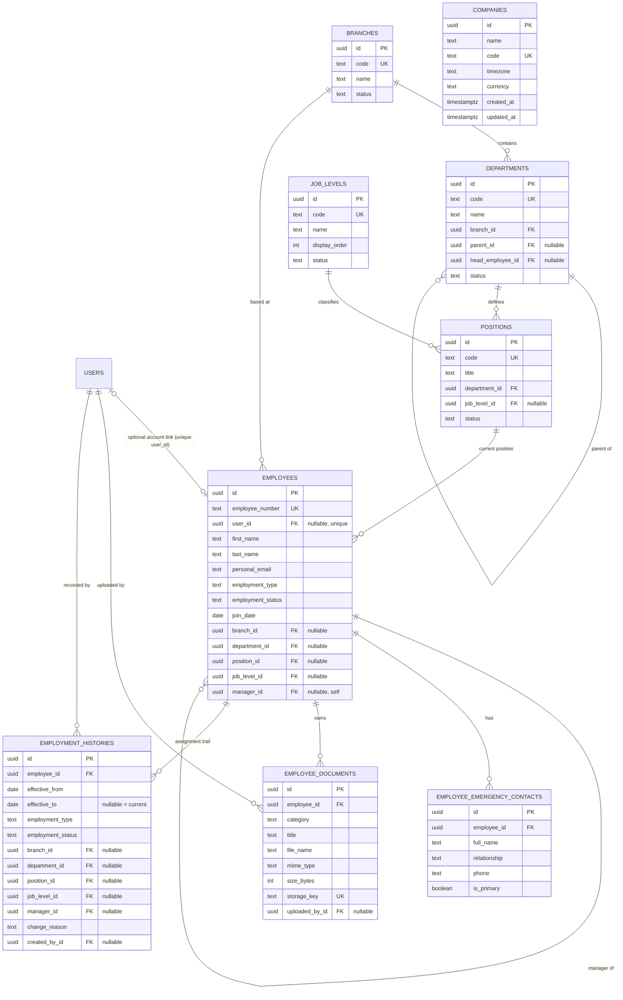

# Phase 3 Database ERD (implemented)

This reflects the applied schema in `packages/database/prisma/schema.prisma` and migration
`20261122055607_organization_employees`. It supersedes the Phase 0 proposal for the tables shown
here; later-phase tables remain proposals.

## Integrity decisions

- **Dates** use PostgreSQL `date` for join/effective dates, so timezone changes cannot shift a work
  date. Timestamps are `timestamptz` in UTC.
- **Employees vs users**: `employees.user_id` is nullable and unique. Deleting a user sets the link
  to null (`onDelete: SetNull`); it never deletes the employee.
- **Manager line**: self-referencing `manager_id` with `onDelete: Restrict`. Self-management and
  cycles are rejected in the service inside the same transaction as the write.
- **Master data** referenced by employees uses `onDelete: Restrict`; the API returns `409` rather
  than cascading. Historical rows use `SetNull` for organization references, so a later archival
  cannot erase where someone worked.
- **Emergencies** cascade with the employee; at most one primary is maintained transactionally by the
  service (no partial unique index in this migration).
- **Documents** store metadata only. `storage_key` is unique; binary content never enters
  PostgreSQL. Deleting an employee cascades metadata, and the storage adapter is asked to remove the
  object.
- **History** is append-only. Index `(employee_id, effective_from)` supports the profile timeline and
  the "open row" lookup. One open row per employee is a service invariant, not a database constraint.
- **Indexes** exist on all employee foreign keys (`branch_id`, `department_id`, `position_id`,
  `job_level_id`, `manager_id`), `employment_status`, names, and `employee_documents.employee_id`.

## Known gaps

- A partial unique index enforcing at most one `is_primary` contact per employee and one open history
  row per employee could be added as defense in depth; current enforcement is transactional in the
  service.
- No trigger prevents manager cycles at the database level, so direct SQL writes bypass the rule.
