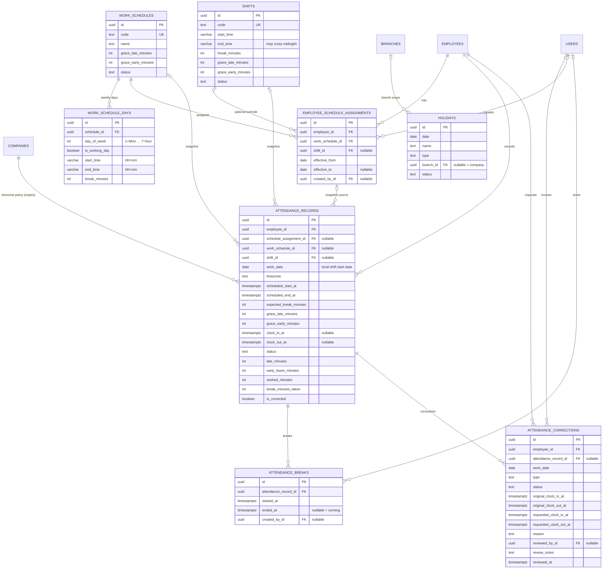

# Phase 4 Database ERD (implemented)

Reflects `packages/database/prisma/schema.prisma` and migration
`20261123083842_attendance`.

## Integrity decisions

- `attendance_records` is unique on `(employee_id, work_date)`, so one work date cannot produce two
  sessions.
- Partial unique indexes enforce one open break per record, one open attendance session per employee,
  one pending correction per record, one pending correction per employee/work date, and one holiday per
  company date or branch date.
- Schedule/shift assignment rows are never deleted by the application. A change closes the previous
  `effective_to` and inserts a new row.
- Attendance rows copy schedule, shift, grace, expected break and timezone values. Master-data edits
  therefore affect only future records.
- Deleting an employee cascades attendance and corrections. Deleting a schedule/shift is restricted
  while assignments reference it; attendance history is not cascaded (nullable snapshot relations use
  `SetNull` when a master row is eventually removed).
- All instants are stored in UTC (`timestamptz`); `work_date`, effective dates and holiday dates are
  PostgreSQL `date` values.
