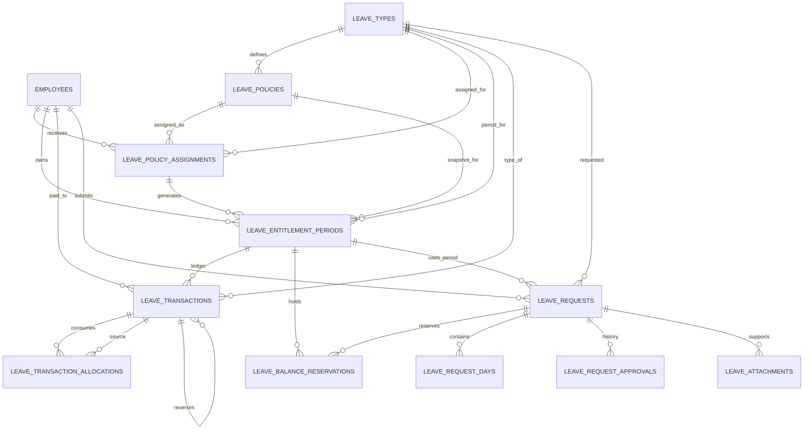

# Phase 5 ERD — Leave Management



```text
LEAVE_TYPES {
  uuid id PK
  text name
  text code UK
  text description
  boolean is_paid
  boolean requires_approval
  boolean requires_attachment
  boolean allow_half_day
  boolean allow_past_dates
  boolean allow_future_dates
  boolean requires_balance
  text status
}

LEAVE_POLICIES {
  uuid id PK
  uuid leave_type_id FK
  text name
  text code UK
  decimal entitlement_amount
  text entitlement_unit
  text accrual_method
  text accrual_frequency
  text accrual_start_rule
  int eligibility_months
  decimal max_balance
  boolean carry_over_enabled
  decimal max_carry_over_amount
  int carry_over_expiration_months
  decimal min_request_duration
  decimal max_request_duration
  int min_advance_notice_days
  boolean allow_negative_balance
  boolean allow_half_day
  boolean allow_unpaid_leave
  text approval_mode
  int leave_year_start_month
  int cancellation_cutoff_days
  date effective_from
  date effective_to
  text status
}

LEAVE_POLICY_ASSIGNMENTS {
  uuid id PK
  uuid employee_id FK
  uuid leave_type_id FK
  uuid policy_id FK
  date effective_from
  date effective_to
  text status
  text notes
  uuid created_by_id FK
}

LEAVE_ENTITLEMENT_PERIODS {
  uuid id PK
  uuid employee_id FK
  uuid leave_type_id FK
  uuid policy_id FK
  uuid assignment_id FK
  date period_start
  date period_end
  decimal entitlement_amount "snapshot"
  text entitlement_unit
  jsonb policy_snapshot
  text status
}

LEAVE_TRANSACTIONS {
  uuid id PK
  uuid employee_id FK
  uuid leave_type_id FK
  uuid entitlement_period_id FK
  text type
  decimal amount "positive credit, negative debit"
  date transaction_date
  date expires_at
  text source_type
  text source_ref
  text description
  uuid created_by_id FK
  uuid reversal_of_id FK "self"
}

LEAVE_TRANSACTION_ALLOCATIONS {
  uuid id PK
  uuid transaction_id FK
  uuid source_transaction_id FK
  decimal amount
}

LEAVE_BALANCE_RESERVATIONS {
  uuid id PK
  uuid request_id FK
  uuid employee_id FK
  uuid leave_type_id FK
  uuid entitlement_period_id FK
  decimal amount
  text status
}

LEAVE_REQUESTS {
  uuid id PK
  uuid employee_id FK
  uuid leave_type_id FK
  uuid entitlement_period_id FK
  text client_request_id
  date start_date
  date end_date
  decimal duration
  text duration_unit
  text request_mode
  text half_day_period
  text reason
  text status
  text approval_stage
  timestamptz submitted_at
  uuid reviewed_by_id FK
  timestamptz reviewed_at
  text review_comments
  timestamptz cancelled_at
  uuid cancelled_by_id FK
  text cancellation_reason
  timestamptz withdrawn_at
}

LEAVE_REQUEST_DAYS {
  uuid id PK
  uuid request_id FK
  date date
  decimal duration
  text half_day_period
}

LEAVE_REQUEST_APPROVALS {
  uuid id PK
  uuid request_id FK
  text stage
  text decision
  uuid actor_user_id FK
  text actor_name
  text comment
  boolean is_override
  timestamptz created_at
}

LEAVE_ATTACHMENTS {
  uuid id PK
  uuid request_id FK
  uuid uploaded_by_id FK
  text file_name
  text mime_type
  int size_bytes
  text storage_key
}

ATTENDANCE_RECORDS {
  uuid id PK
  uuid employee_id FK
  date work_date
  text status "includes ON_LEAVE"
}
```

## Integrity decisions

- `leave_transactions` has a unique `(source_type, source_ref, type)` key. This is the database-level
  idempotency guarantee for entitlement, accrual, carry-over, and expiration.
- `leave_entitlement_periods` is unique on `(employee_id, leave_type_id, period_start, period_end)`.
- `leave_requests` is unique on `(employee_id, client_request_id)` when provided.
- `leave_balance_reservations` has at most one active reservation per request.
- Active policy assignments for the same employee/type are protected by a PostgreSQL exclusion
  constraint over `daterange(effective_from, effective_to, '[]')`.
- Active leave requests are protected by an exclusion constraint over their date range. Drafts and
  rejected/withdrawn/cancelled requests do not block a new request.
- Ledger rows are append-only; cancellation writes a reversal instead of deleting a deduction.
- `leave_entitlement_periods.policy_snapshot` freezes rules so later policy edits cannot rewrite
  history.
- Attachment storage keys are private; there is no public path.
- Employee deletion is restricted by entitlement periods, transactions, requests, and reservations.
  The application closes assignments or deactivation workflows instead of deleting leave history.
